# RepoDeck

**A friendly Git desktop app for people who juggle several repos at once.**

RepoDeck puts every repo you're working on side by side, explains git in plain English, and shows you exactly which git commands it runs. Almost every action can be undone with one click. A built-in Claude panel can look at and change your branches, and you approve each change.

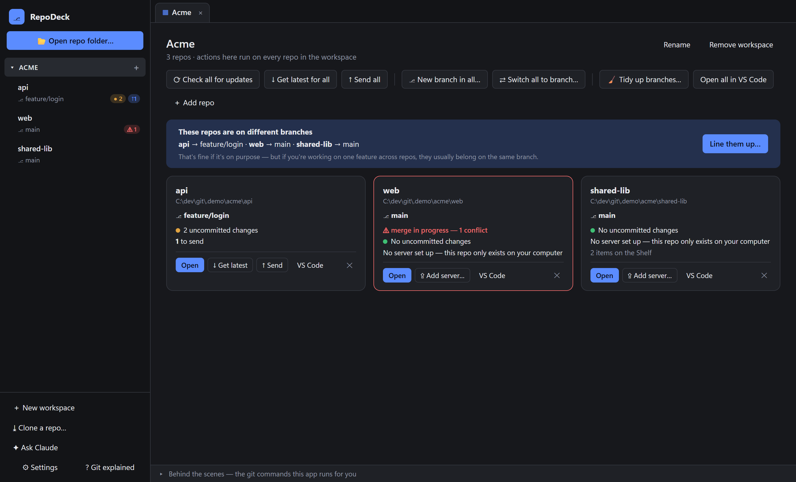

## Why RepoDeck?

Most git tools assume you already know git and that you work in one repo at a time. RepoDeck is built for the opposite case:

- **Projects that span several repos.** Group them into a *workspace*, then check, pull, push, branch, switch or tidy all of them at once. RepoDeck warns you when they're on different branches.
- **Plain English.** Buttons say *Get latest*, *Send* and *Put on Shelf* instead of `pull`, `push` and `stash`. Hover any button to see the real git command.
- **Nothing hidden.** Hold <kbd>Shift</kbd> while clicking any button to preview the exact commands before they run. The *Behind the scenes* drawer logs everything that ran.
- **Hard to lose work.** Commits, merges, pulls, cherry-picks, branch switches and deletes all offer **Undo**. Discarded changes go to the Shelf. Merges and cherry-picks can be aborted.
- **Works with your editor.** Keep coding in VS Code or Cursor. RepoDeck watches your folders and updates the moment files change.

## Features

### Workspaces and tabs

- **Open repo folder** (or drag folders onto the window), or clone one. Group related repos into **workspaces**.
- The sidebar shows each repo's branch, uncommitted changes (●), commits to send (↑) and commits to get (↓).
- **Workspace actions** run on every repo at once: check for updates, get latest, send, *New branch in all*, *Switch all to branch*, *Tidy up branches*, *Open all in VS Code*.
- If your repos are on different branches, a banner says so and offers **Line them up**.
- Each repo opens in its own **tab**, and tabs are remembered between launches.

### Changes and commits

- Tick the files you want, write a summary, and click **Commit** or **Commit & Send**. There's no staging area to think about.
- **✦ Write message:** Claude writes the commit message from your ticked changes.
- **Type buttons** (`feat`, `fix`, `docs`…) and an optional message template.
- **Amend** the last commit, as long as it hasn't been sent.
- **Commit only some lines.** Untick single lines, or a whole block, in the diff to leave them out. They stay in your folder as uncommitted changes. A file with some lines left out shows a half-ticked box.
- Diffs have syntax colours and highlight the changed words, shown **inline** or **side by side**.

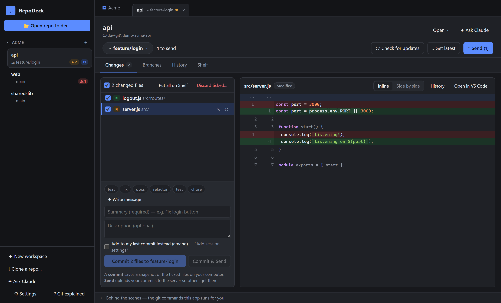

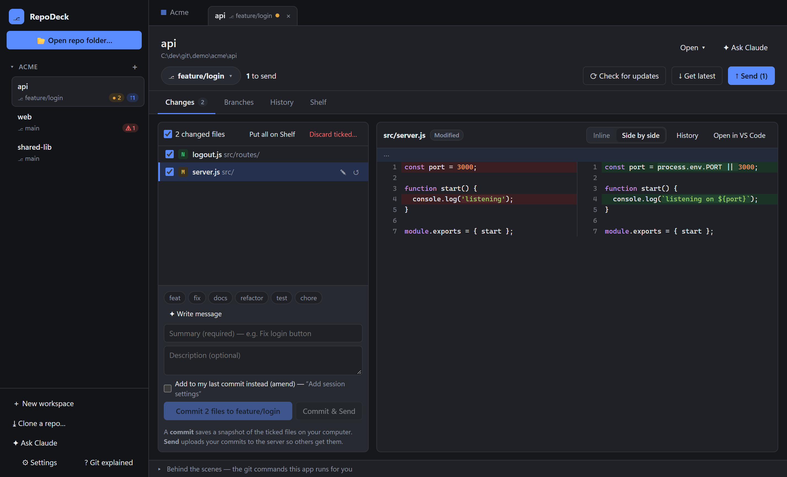

### Undo

After a commit, merge, get latest, update from another branch, reversed commit, cherry-pick, branch switch, branch delete or Shelf delete, a message with an **Undo** button appears. If something was already sent to the server, RepoDeck says so instead of quietly rewriting it.

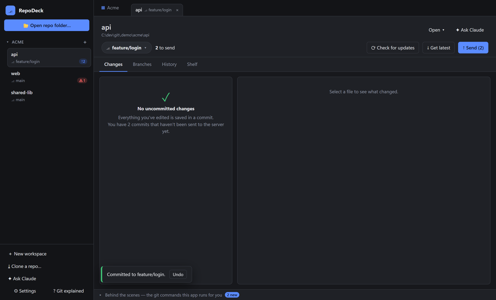

### Branches

- Click the branch name for a **quick switcher**: type to filter, then <kbd>Enter</kbd> to switch, or create a new branch.
- Switching with uncommitted changes asks whether to **bring them along** or **leave them on the Shelf**. If you leave them, RepoDeck offers to put them back when you return.
- **Update from…** brings in the new commits from any branch you pick, such as `main`, `dev` or a teammate's branch, by **merge** or **rebase**. It shows how many commits you'll get and remembers your choice for each branch. Rebase is turned off once your commits are on the server, because it would rewrite them.
- **Compare** two branches: what one has that the other doesn't, either *since they split* (what a pull request would show) or the *exact difference*. You get the commits, the changed files with line counts, and each file's diff.
- **Tidy up** finds branches that are merged, or were deleted on the server after a pull request, and removes them in one go (with Undo).
- After you **Send** a feature branch, RepoDeck offers to **open a pull request** on GitHub, Azure DevOps, GitLab or Bitbucket.

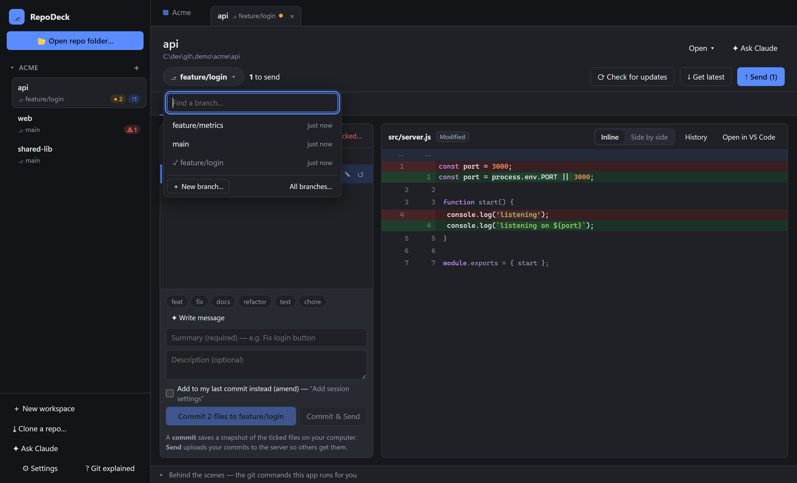

### History and cherry-pick

- A **commit graph**, **search** by message, author or hash, and **history of a single file**.
- **✦ Explain** asks Claude what a commit did and why.
- **Reverse this commit** (`git revert`) backs out any earlier commit by adding one that does the opposite. It's safe even after the commit was sent, unlike Undo.
- **Cherry-pick:** open any branch, tick commits, and copy them into your branch. Commits already there are hidden.
- **Copy to another branch** works without switching yourself: RepoDeck shelves your work, switches, cherry-picks, comes back and restores it.
- If a cherry-pick stops with a conflict, you can **Continue**, **Skip this commit** or **Abort**.

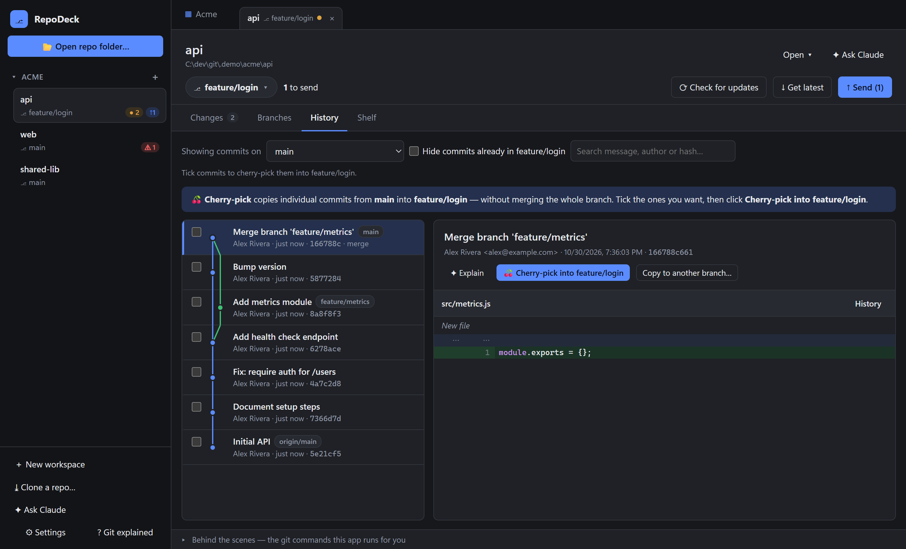

### Merge conflicts, three ways

1. **Step by step:** each clash side by side. Pick *yours*, *theirs*, *both*, or edit by hand.
2. **Compare side by side:** the whole file lined up. You can also compare either side against the *original*, to see what each side actually changed.
3. **Edit the result:** edit the final file directly before saving.

There's also **✦ Explain** (Claude describes the clash), a one-click **Open in VS Code / Cursor merge editor**, and **Abort** always puts everything back.

| Step by step | Compare side by side |
|---|---|
| 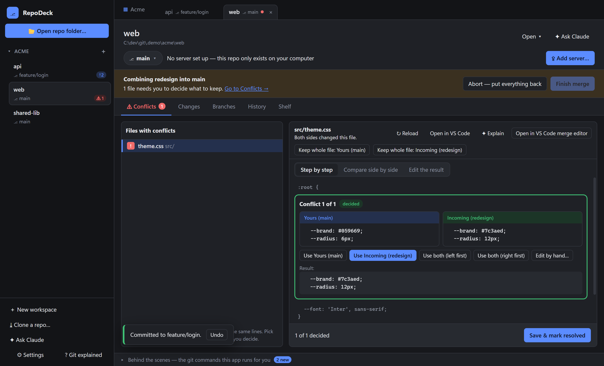 | 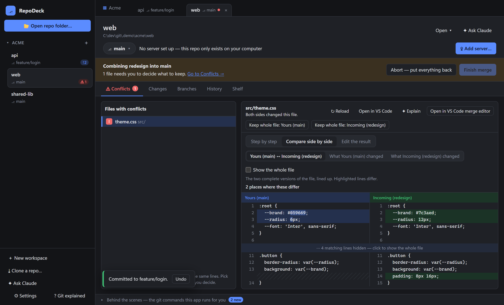 |

### The Shelf (git stash)

- A safe drawer for unfinished edits. Put changes aside to get a clean folder, then restore them later.
- Safety copies from **Discard** are kept in their own group, with a one-click clean-up of old ones.

### See every command before it runs

Hold <kbd>Shift</kbd> and click any button, or turn previews on for everything in Settings. Every step is listed with a plain-English note, and you can copy the commands.

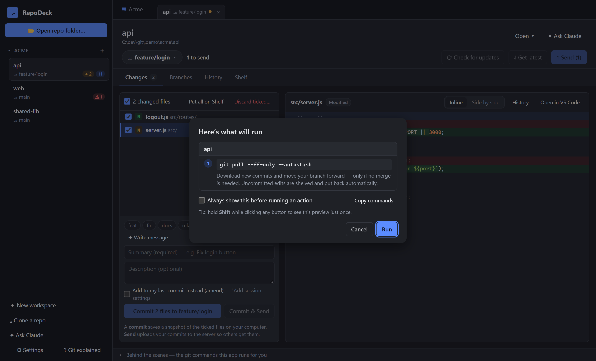

### Command palette

Press <kbd>Ctrl</kbd>+<kbd>K</kbd> to jump to any repo or workspace, switch branch, or run any action by typing a few letters.

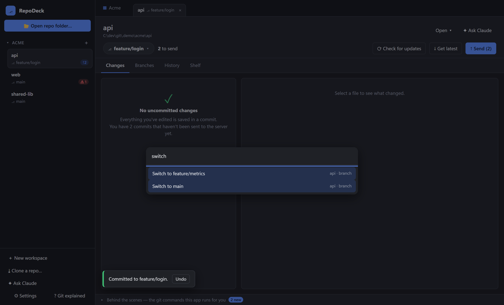

### Claude panel

Ask Claude about your repos in plain English, for example *"Which commits on main aren't in my branch?"*, *"Make a branch called fix/users-auth from main"* or *"Why can't I push?"*.

- It runs the **[Claude Code](https://claude.com/claude-code) app you already have installed**, signed in as you. No API key needed.
- Claude works in the repo you're viewing and can see the other repos in the same workspace.
- It can **read files and run read-only git commands freely**.
- **Anything that changes something** waits on an approval card showing the exact command or edit. Risky commands such as force-push or `reset --hard` are flagged.
- **Always allow …** lets a kind of command (say, `git switch`) through for the rest of a chat. Risky commands always ask.
- Each workspace keeps its **own chats**. They're saved between launches, and earlier ones are under **History**.
- ✦ buttons around the app (**Write message**, **Explain** a commit or conflict, **Ask Claude why** on errors) send Claude the right question for you.
- Open it with <kbd>Ctrl</kbd>+<kbd>J</kbd>.

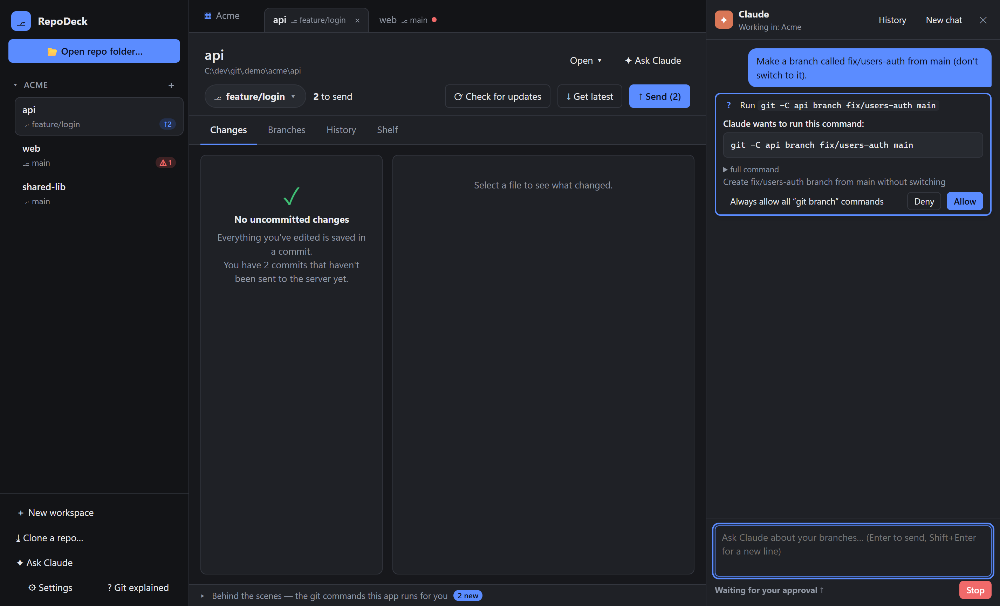

### More

- **Progress and Cancel** for clone, fetch, pull and push.
- **Light, dark, or follow Windows.**
- **Friendly errors**, with the raw git output and **✦ Ask Claude why** one click away.
- **Keyboard friendly:** visible focus, dialogs keep keyboard focus inside them, and screen-reader labels.
- **Git explained:** a built-in plain-English glossary.

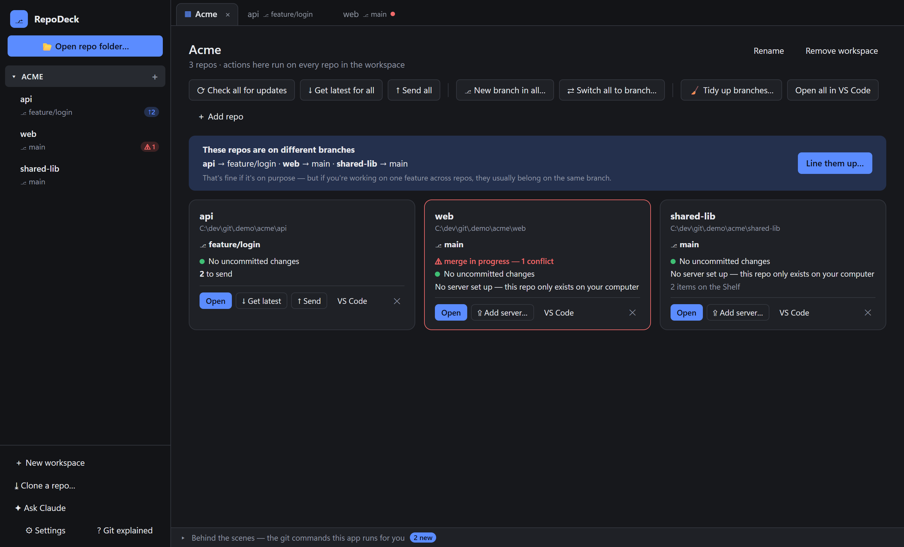

## Getting started

**Requirements**

- Windows 10 or 11 (other platforms are untested)
- [Git](https://git-scm.com/) on your `PATH`
- Optional: [Claude Code](https://claude.com/claude-code) (`claude`), for the Claude features

**Install:** run `RepoDeck Setup <version>.exe` (one installer for both x64 and ARM64 Windows).

**Or run from source** (needs [Node.js](https://nodejs.org/) 20 or newer):

```bash
git clone <this repo>
cd repodeck
npm install
npm start
```

Then click **📂 Open repo folder…** (or drag a folder onto the window). On first launch RepoDeck asks for your name and email if git doesn't have them yet.

### Settings

| Setting | What it does |
|---|---|
| Theme | Follow Windows, Light or Dark |
| Editor | Which editor *Open in…* uses: VS Code, Cursor, or any command |
| Commits | A summary template (e.g. `ABC-123: `) and the quick type buttons |
| Preview commands | Always show git commands before running an action |
| Cherry-pick note | Add “(cherry picked from commit …)” to cherry-picked commits |
| Claude | Path to `claude.exe` (found automatically if empty) and model |
| Automatic checking | How often to check servers for new commits |

Settings and workspaces are stored in `%APPDATA%\repodeck\config.json`, and Claude chats in `chats.json` next to it.

## Keyboard shortcuts

| Keys | Action |
|---|---|
| <kbd>Ctrl</kbd>+<kbd>K</kbd> | Command palette |
| <kbd>Ctrl</kbd>+<kbd>J</kbd> | Open or close the Claude panel |
| <kbd>Ctrl</kbd>+<kbd>Enter</kbd> | Commit (in the commit box) |
| <kbd>Shift</kbd>+click | Preview a button's git commands |
| <kbd>Ctrl</kbd>+<kbd>Tab</kbd> / <kbd>Ctrl</kbd>+<kbd>Shift</kbd>+<kbd>Tab</kbd> | Next / previous tab |
| <kbd>Ctrl</kbd>+<kbd>1</kbd>…<kbd>9</kbd> | Jump to a tab |
| <kbd>Ctrl</kbd>+<kbd>W</kbd> or middle-click | Close tab |
| <kbd>F5</kbd> | Refresh everything |

## Development

```bash
npm start      # run the app
npm test       # run the tests (git operations run against throwaway repos)
npm run check  # syntax-check every source file
npm run dist   # build the Windows installer into dist/
```

**Auto-update:** installed copies check for updates when a `publish` target is set in the `build` section of `package.json` (for example `"publish": { "provider": "github", "owner": "you", "repo": "repodeck" }`). Without one, update checks are skipped.

### How it works

RepoDeck is an [Electron](https://www.electronjs.org/) app with no build step and no git library. Every action runs the real `git` command line, so what happens is exactly what you'd get in a terminal.

| Path | What's there |
|---|---|
| `main.js` | Electron main process: window, settings, folder watching, editor and terminal launching, updates |
| `src/git.js` | Every git operation, with progress, cancel and plain-English previews |
| `src/claude.js` | Runs Claude Code headless and routes its permission prompts to RepoDeck's approval cards |
| `preload.js` | The bridge between the UI and the main process |
| `renderer/app.js` | The UI |
| `renderer/lib.js` | Pure helpers (diff, conflict parsing, syntax colours, graph, search), unit tested |
| `test/` | Tests (`node --test`) |

Commands that could hang, such as editor or password prompts, are disabled. File names are passed to git literally, so names like `app [1].txt` work.
